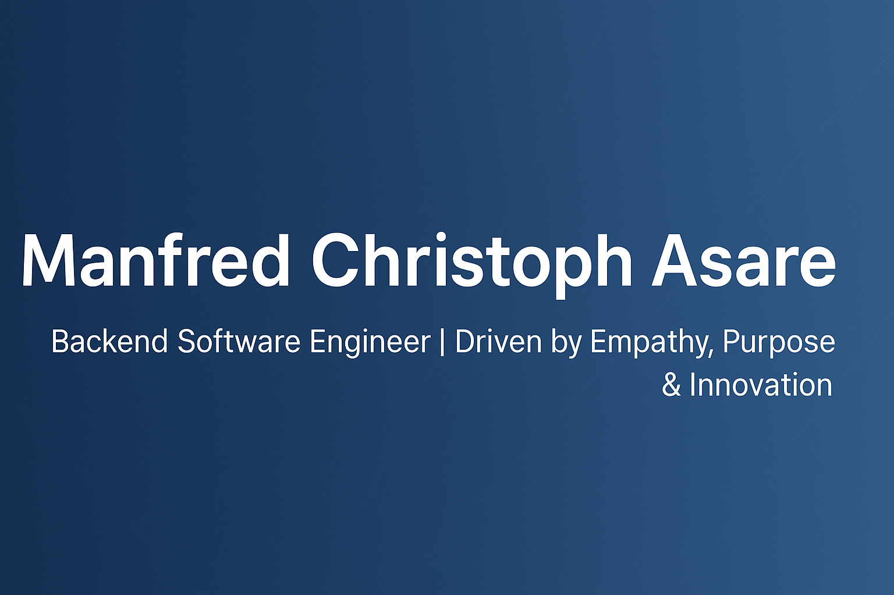

<!-- Minimal Elegant Banner -->

  

# Hi — I'm Manfred Christoph Asare 👋  

  <strong>cloud Engineering learner</strong> • designing systems that empower communities and drive meaningful change across health, agriculture, and fintech in Africa.

  
  
  

---

# About Me

  

    I am a compassionate and visionary individual driven by empathy, imagination, and purpose. My journey began in biomedical science, evolved through managing hospital construction projects, and now finds expression in backend software engineering. I see technology as a bridge to close the gaps in Africa’s healthcare, agricultural, and fintech infrastructures.
  

  

    Guided by intention, I seek wisdom, growth, and excellence—creating systems that heal, empower, and leave a lasting impact on society. I build not just with code, but with care, creativity, and a commitment to serve.
  

  
<strong>More about my background</strong>

  - 🎓 Cloud Engineering learner (in progress, expected July 2027)  
  - 💼 Project Engineer managing district hospital constructions across Ghana  
  - 👨‍👩‍👧 Husband and father — family inspires my drive to build responsibly and meaningfully  
  - 🌍 Based in Accra, Ghana  
  - ❤️ Passionate about: backend systems, healthtech, agritech, and fintech innovations  
  - ⚡ Core traits: empathy · imagination · humility · growth mindset · integrity

---

# Vision
> To live with intention—growing in wisdom, spirit, and skill while leveraging technology to build systems that empower, heal, and create lasting impact.

---

# What I Want to Build / Work On
I want to work on:
- Scalable backend solutions that solve real-world problems in **healthtech**, **agritech**, and **fintech**.  
- Cloud-powered systems that **support smallholder farmers**, **improve hospital operations**, and **enhance access to digital finance**.  
- Collaborative projects that merge **AI, big data, and backend engineering** to deliver meaningful, sustainable impact.

---

# Featured Projects

  <em>🚀 I’m currently developing my first major backend project — I’ll be updating this section soon with full details, documentation, and live demos.</em>

---

# Skills & Tools

<strong>Languages:</strong> Python · JavaScript (Node.js) · SQL

<strong>Backend Frameworks:</strong> FastAPI · Express.js

<strong>Databases:</strong> PostgreSQL · Redis

<strong>DevOps / Cloud:</strong> Docker · GitHub Actions · Google Cloud · Nginx

<strong>Testing:</strong> pytest · unittest

<strong>Soft Skills:</strong> Leadership · Emotional Intelligence · Collaboration · Creative Problem-Solving

---

# How I Work
1. Understand the real-world problem and its human impact  
2. Design a clear system architecture and API contract  
3. Develop iteratively with tests and CI/CD pipelines  
4. Deploy, monitor, and optimize for reliability and scalability  
5. Reflect and document lessons learned for continuous improvement  

---

# Resume & Contact

  <strong>📄 Resume:</strong> Coming soon. 
  <strong>✉️ Email:</strong> <a href="mailto:asare1obeng@gmail.com">asare1obeng@gmail.com</a> 
  <strong>🔗 LinkedIn:</strong> <a href="https://www.linkedin.com/in/manfred-christoph-obeng-asare-202557263/">Connect</a> 
  <strong>💻 GitHub:</strong> <a href="https://github.com/ManfredChristoph">ManfredChristoph</a>

---

# Open To
- Cloud engineering roles (remote or hybrid)  
- Impact-driven collaborations in healthtech, agritech, or fintech  
- Mentorship and cross-disciplinary projects that blend engineering, empathy, and impact  

---

# GitHub Stats

  
  

---

<footer>
  

    “Technology is my bridge — empathy is my foundation. Through both, I strive to build a world where systems serve people and progress uplifts everyone.”
  

</footer>
